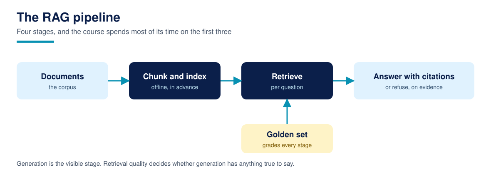

# Lesson 01: Why naive RAG fails: the five failure modes

**Time:** about 60 minutes · **Difficulty:** Introductory · **Prerequisites:** Lesson 00 · **You need:** The corpus, skimmed once.

The naive pipeline is the one in every demo: take your documents as they are, index them with the first retriever that comes to hand, take the top results, and hand them to a model as context. This lesson builds exactly that (whole documents, one TF-IDF index, top 5, no chunking, no filters, no refusal), measures it on the golden set, and finds the result that surprises everyone the first time: on a small, clean corpus, its recall is perfect. Then it measures the five things recall does not capture, and there the naive pipeline fails on every one. The rest of the course is the systematic repair of these five failures, so this lesson is the map.

## Failure 1: it leaks

The naive index has no concept of roles, so a public question can retrieve the staff discount policy or the supplier agreement as context. On this corpus, 11 of the 30 golden questions asked in the public role pull a restricted document into their top 5. In a demo that is invisible; the model simply knows things it should not. In production it is the incident report. Lesson 12 fixes this with metadata filters enforced before ranking, and takes the count to zero.

## Failure 2: it answers everything

The naive pipeline has no refusal behaviour: asked for the cafe wifi password, the price match policy, or the staff discount figure as a public reader, it retrieves its least bad match and would answer from it. All 6 refuse-expected golden questions get a confident retrieval. A system that cannot say "the documents do not cover that" will eventually invent, or leak, its way to an answer. Lesson 20 builds the refusal rules and grades them.

## Failure 3: it cannot tell current from stale

The corpus holds three sale documents: the current autumn terms, the superseded spring terms, and an archive of older offers. The naive pipeline ranks them purely on words, so yesterday's discount sits in the context beside today's, and a generated answer can cite either. Lesson 25 adds supersession handling: stale documents leave the context unless the question names their period.

## Failure 4: it pays for context it does not use

Whole documents are long. The naive top 5 averages about 420 words of context per question, against about 118 for the chunked systems built later, and most of those words are irrelevant to the question asked. Context is not free: it costs tokens, latency, and the model's attention. Lessons 03 and 04 fix this with chunking; Lesson 14 adds budgets.

## Failure 5: its ranking is a coin toss at the top

Mean reciprocal rank (MRR) measures how often the first result is the right document. The naive pipeline scores 0.9295: good, not great, and its errors concentrate exactly where you would predict, on multi-hop questions, whose evidence lives in two documents a single ranking must surface together. Lessons 11 and 16 to 24 attack ranking quality and multi-hop retrieval directly.

## The number that should make you suspicious

And yet: document recall at 5 is 1.0, fact recall at 5 is 1.0. On 24 short, well separated documents, almost any retriever finds the facts. That is precisely why this course grades more than recall, and why Lesson 19 teaches golden set design: a metric that cannot fail cannot teach. When you build your own golden set, include the questions your system should refuse, the documents it must never show, and the stale fact it must not repeat, or your scoreboard will flatter you the way this one flatters the naive pipeline.

## Run it

Run `python3 naive_rag.py`. `evaluate()` returns the stage table plus the failure counts: 11 leaking questions among the 30 asked in the public role, 6 of 6 refuse questions answered, about 420 average context words. Keep these numbers; every later lesson reports against them.

## Common failures

- **Judging a RAG system by recall alone.** Recall said this pipeline was perfect while it leaked supplier margins. Grade leaks, staleness, and refusal from the start.
- **Assuming a bigger corpus fixes behaviour.** Scale makes ranking harder, not easier; the five failures here are design absences, not size problems.
- **Skipping the baseline.** Every later improvement in this course is claimed against this lesson's numbers. Without a measured baseline, "improvement" is a mood.

## Recap checklist

- [ ] I can name the five failure modes and the lesson that repairs each.
- [ ] I ran the naive pipeline and saw perfect recall beside 11 leaking questions.
- [ ] I understand why the course grades refusal, leaks, and staleness alongside recall.

## Resources

- [Anthropic, Contextual Retrieval](https://www.anthropic.com/news/contextual-retrieval): what a production grade pipeline adds, with measured effects (RESEARCH.md records the figures)
- [Course 1, Lesson 18: RAG from scratch](https://github.com/techaurah/agentic-ai-for-beginners): the four step picture this lesson stress tests
- [Course glossary](../resources/glossary.md)
