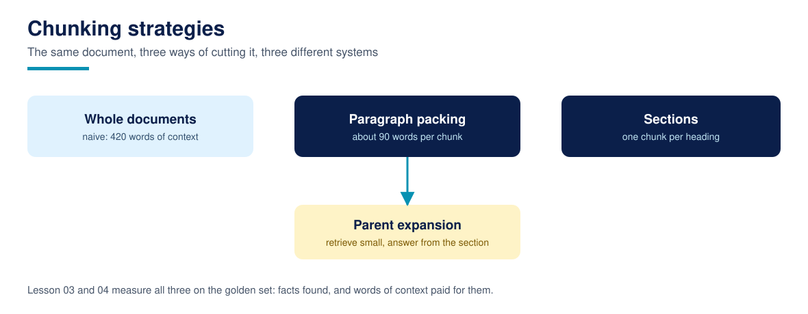

# Lesson 03: Chunking from first principles: size, overlap, and boundaries

**Time:** about 75 minutes · **Difficulty:** Beginner · **Prerequisites:** Lessons 00 to 02 · **You need:** The corpus and its audit numbers from Lesson 02.

A model cannot use a 40 page PDF as evidence; it can use three relevant paragraphs. Chunking is the cut that turns documents into evidence, and it is the first real design decision in any RAG system. This lesson builds three chunkers over the Fernhill corpus, retrieves with the same TF-IDF index over each, and lets the golden set judge: how many facts survive the cut, and how many words of context you pay for them.

## The three chunkers

**Whole documents** (Lesson 01's unit): 24 chunks. Nothing is lost, and nothing is focused: a question about cafe kitchen hours drags the whole cafe document, and every other document retrieved whole, into the context.

**Paragraph packing**: paragraphs are packed in order into chunks of about 90 words, breaking at section headings so a chunk never straddles two sections. On this corpus it produces 84 chunks averaging about 24 words of body text each; Fernhill's paragraphs are short, and the document title and section heading join the text at index time rather than in the stored chunk. Packing respects the author's own paragraph boundaries instead of slicing mid sentence.

**Section chunking**: one chunk per headed section, 84 chunks here as well, because the corpus's sections are short; on real documents sections vary wildly in length, which is this strategy's known weakness and Lesson 04's subject.

## What the measurement says

Fact recall at 5 with role filtering: whole documents 1.0 (nothing is lost, ever), paragraph chunks 0.9808, section chunks at the same level (the artifact prints both). The small recall cost of chunking is real: one golden question's fact lives in a paragraph that packing separated from the words the question uses. Now the other side of the ledger: average context per question falls from 411 words (whole) to 116 words (paragraph chunks). That is the trade this whole course is built on: a point or two of recall for a threefold cut in context cost, and ranking that can finally distinguish one part of a document from another. Production chunking adds overlap (carrying the tail of the previous chunk into the next) to heal boundary cuts; the exercise makes you measure whether overlap earns its words on this corpus.

## Size is a knob, not a virtue

Ninety words is not a recommendation; it is this corpus's setting, chosen because Fernhill's sections run short. The principles transfer, the number does not. Chunks must be big enough to contain a complete fact (the delivery charge and its threshold live in different paragraphs of the delivery policy, and a chunker that separates them has manufactured a multi-hop question out of a single-hop one), small enough that a ranking can prefer the right one, and cut at boundaries a human would recognise: paragraphs, sections, list items. When in doubt, measure two sizes on your golden set; Lesson 18's harness makes that a five minute experiment instead of an argument.

## Run it

Run `python3 chunking.py`. `evaluate()` returns the three chunk counts, each strategy's fact recall at 5, and each strategy's average context words. The whole course standardises on paragraph packing from here: it is the setting every later lesson's numbers assume.

## Common failures

- **Slicing by characters mid sentence.** A chunk that ends "refunds are made to the original payment" retrieves well and reads badly; the generator inherits the wound. Cut at linguistic boundaries.
- **Chunking before reading.** The right size follows the documents' own structure (Lesson 02's audit), not a blog post's default. Read first, then cut.
- **No overlap and no packing discipline on long documents.** On real corpora, facts straddle boundaries; overlap is the standard bandage, priced in context words. Measure it, do not assume it.

## Recap checklist

- [ ] I can explain the recall versus context cost trade with this corpus's numbers.
- [ ] I know the course's standard chunker and its target size, and why it is not a universal default.
- [ ] I can name the boundary rule (never straddle a section) and the reason for it.

## Resources

- [Anthropic, Contextual Retrieval](https://www.anthropic.com/news/contextual-retrieval): what to prepend when chunks lose their document context, Lesson 14's subject
- [Course glossary](../resources/glossary.md)
