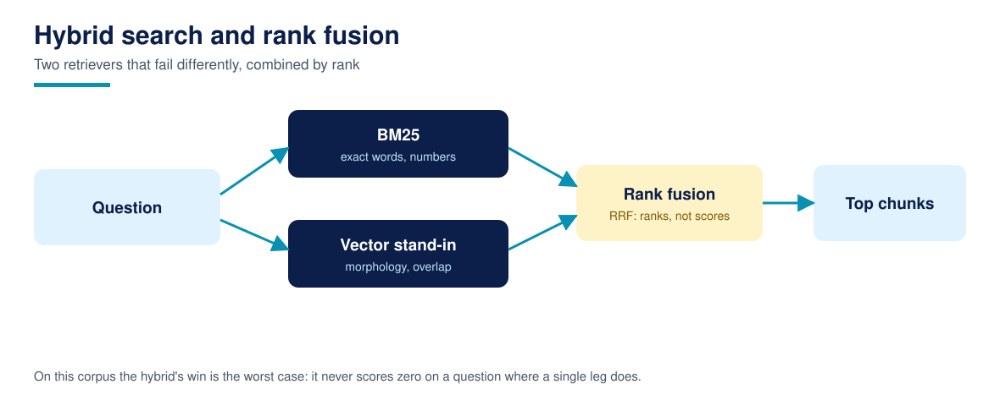

# Lesson 11: Hybrid search and fusion: reciprocal rank fusion

**Time:** about 75 minutes · **Difficulty:** Intermediate · **Prerequisites:** Lessons 05, 06, and 09 · **You need:** The three legs' stage tables from those lessons.

Each retriever you have built fails differently: TF-IDF and BM25 are blind to vocabulary gaps, the vector stand-in is blind to exact figures' importance, and each has a golden question where its fact recall at 5 is 0.0 or 0.5. Hybrid search runs several retrievers and fuses their rankings, on the principle that a chunk two systems rank highly is likelier right than a chunk one system loves. This lesson implements the standard fusion, reciprocal rank fusion (RRF), and measures what it actually buys.

## RRF: ranks, not scores

BM25 scores run to the teens, cosines live between 0 and 1, and no honest rescaling marries them. RRF sidesteps scores entirely: a chunk's fused score is the sum over rankings of 1 / (c + rank), with c = 60 the usual damping constant, so being 1st in one list and 5th in another beats being 3rd in both by a hair, and a chunk absent from a list simply gets nothing from it. The course's hybrid fuses BM25 and the vector stand-in, each returning 20 candidates, fused to the top k. It is simple, parameter light, and the industry default for a reason: it degrades gracefully when one leg is weak, because ranks carry no assumption that the legs' scores mean the same thing.

## The measured verdict

Hybrid stage table: document recall at 5 of 0.9808, fact recall at 5 of 0.9808, MRR of 0.9231. The means barely move versus the best legs; that is not the point of fusion. The point is in the worst case column: TF-IDF's worst question scores 0.5, BM25's worst 0.0, the vector leg's worst 0.0, and the hybrid's worst is 0.5. Each leg is imperfect on exactly one question, but they are imperfect on different questions, so the fused system has no zero anywhere. Fusion is insurance: you pay a little peak performance (the vector leg's MRR of 0.9423 stands above the hybrid's 0.9231) to remove single points of catastrophic failure. Systems that serve real users buy that insurance; demos that chase a leaderboard number often do not, and the difference shows up in the worst conversation, not the average one.

## What fusion cannot fix

Fusion combines rankings; it cannot create candidates. If no leg retrieves the gold chunk into its 20, the fused list cannot contain it either, which is why the legs here return 20 for a top 5: candidate depth is fusion's fuel. It also cannot fix shared blindness: greenfly defeats BM25 and the stand-in alike (Lesson 15's territory), and a leak is a leak in every leg until Lesson 12 filters before ranking rather than after.

## Run it

Run `python3 hybrid.py`. `evaluate()` returns the hybrid stage table, each leg's fact recall and worst case, and the below-perfect counts (one question each). Find the hybrid's one imperfect question and check which leg caused it; Lesson 13 will try, and mostly fail, to repair ranking further.

## Common failures

- **Fusing raw scores.** Averaging a BM25 score of 11.4 with a cosine of 0.59 produces a number dominated by whichever scale is larger. Fuse ranks (RRF) or normalise with your eyes open.
- **Shallow candidate lists.** Fusing two top 3 lists gives fusion nothing to work with. Legs should return several times the final k.
- **Expecting fusion to fix coverage.** If the fact is not in any candidate set, no combination rule retrieves it. Coverage problems are corpus and query problems (Lessons 02, 15, 16), not fusion problems.

## Recap checklist

- [ ] I can write the RRF formula and explain why it uses ranks.
- [ ] I know the hybrid's stage table and its worst case against each leg's.
- [ ] I can state fusion's limit: it cannot create candidates or fix shared blindness.

## Resources

- [Course glossary](../resources/glossary.md)
- [RESEARCH.md](../RESEARCH.md): Anthropic's contextual retrieval pairs lexical and vector legs for the same reason
