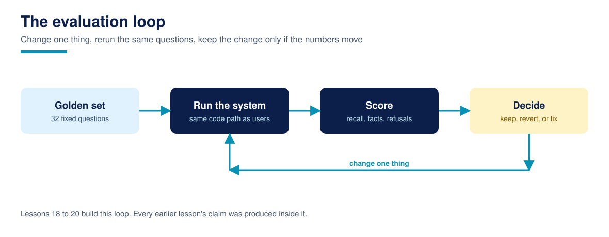

# Lesson 20: Grounding and refusal: answers that know their limits

**Time:** about 90 minutes · **Difficulty:** Intermediate · **Prerequisites:** Lessons 12, 14, and 19 · **You need:** The full stack assembled so far; this lesson switches it on as an answerer.

Retrieval grades evidence. Users meet answers. This lesson completes the pipeline with an extractive answer composer (it answers with one sentence copied from a retrieved chunk, cited to its document and section, the stdlib honest stand-in for a generating model) wrapped in refusal rules, and grades the whole thing as an answerer: refusal accuracy, citation coverage, grounding, and fact completeness. It also grades the lesson this course considers the most transferable: a score threshold cannot do this job.

## The refusal rules

The composer refuses when the question carries at least two content concepts the permitted corpus does not contain at all (the wifi password question's "wifi" and "password" are both unseen), or when no retrieved sentence shares enough specific vocabulary with the question, or when a quantity question's best sentence contains no digit. The unseen concepts test is the workhorse, and its threshold is a dial with measured consequences: at a threshold of 1 (refuse on a single unseen concept), refusal is perfect, 6 of 6, but 9 answerable questions are falsely refused, including paraphrases and multi-hop questions whose wording outruns the corpus's vocabulary. At the course's setting of 2: refusal 5 of 6, false refusals 0 of 26. At 3: refusal falls to 4 of 6. There is no free threshold; there is a chosen trade, published with the numbers, which is what an honest refusal policy looks like.

## The scorecard

Refused correctly: 5 of 6. The miss is q24 (price matching): its words all exist in the corpus, and a welcome sentence shares enough of them to pass the grounding rules, so the system answers "Welcome to Fernhill Garden Centres." to a question it should refuse. The course leaves this failure in, named, because it is the generic one: unanswerable questions phrased entirely in corpus vocabulary defeat vocabulary based refusal, and catching them needs answer level judgement (a model checking entailment, RAGAS style faithfulness, or a curated blocklist of intents), which the capstone's gates accept as a known miss with a documented cause rather than a hidden one. False refusals: 0 of 26. Citation coverage: 26 of 26 answers carry a citation. Grounded sentences: 26 of 26, every answer sentence literally present in its cited chunk (guaranteed by extraction here; a generating model must be checked for it, which is the checker's real purpose). Full fact answers: 21 of 26 answered questions' sentences contain all their gold facts; the other 5 are single sentence limits, facts split across sentences, the known ceiling of the extractive stand-in and the honest reason production systems generate.

## Why thresholds on retrieval scores cannot refuse

The tempting shortcut, refuse when the top score is low, fails measurably on this corpus (the build experiments behind this course recorded it): BM25 top 1 scores for answerable questions dip to 6.49 while refuse questions reach 11.43; vector cosines overlap the same way (0.286 against 0.588). Relevance scores measure similarity to something, and an unanswerable question can be very similar to a real document (price matching sits beside prices everywhere). Refusal is a claim about coverage (does the corpus contain this concept at all), and coverage needs its own test, which is what the unseen concepts rule is.

## Run it

Run `python3 grounded_answers.py`. `evaluate()` returns the scorecard and both neighbouring thresholds' trades. This exact pipeline, productised, is what the capstone assembles in Lesson 29 and gates in Lesson 30.

## Common failures

- **Refusing by score threshold.** Measured above: the distributions overlap, the policy fails in both directions, and it fails silently. Test coverage, not similarity.
- **Refusals that leak.** "We cannot tell you the staff discount" confirms the document exists. Refuse neutrally (the documents available to you do not cover that), the same sentence used for genuinely absent topics.
- **Counting extraction's grounding as a model's.** The checker matters most for generated text. Keep it running when the composer becomes a model in your own system; that is what it is for.

## Recap checklist

- [ ] I know the scorecard: refusal 5 of 6 (miss q24, named), false refusals 0, citations and grounding 26 of 26, full facts 21 of 26.
- [ ] I can explain the threshold dial's three measured settings.
- [ ] I can argue, with numbers, why score thresholds cannot implement refusal.

## Resources

- [Course 1, Lesson 20: Grounding and citations](https://github.com/techaurah/agentic-ai-for-beginners): this lesson's predecessor in miniature
- [Course glossary](../resources/glossary.md)
