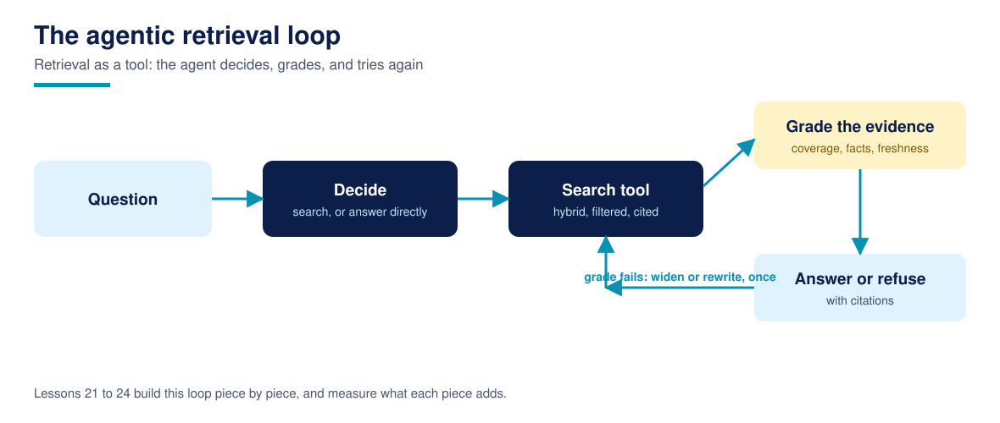

# Lesson 21: Retrieval as a tool: the agent decides

**Time:** about 60 minutes · **Difficulty:** Intermediate · **Prerequisites:** Lessons 14 and 20 · **You need:** Course 1's tool using agent picture refreshed (its Lessons 10 to 12).

Everything so far assumed retrieval always runs. An agent breaks that assumption: it sees greetings, follow ups, and questions the corpus cannot help with, and calling search for all of them wastes money and pollutes answers with irrelevant context. This module gives retrieval a tool's shape and the agent a decision: search_corpus takes a query, a role, and a depth, and returns structured, labelled, cited results or a structured error; a gate decides whether the message earns a search at all. Agentic RAG starts here, with the boundary, not with a framework.

## The contract

The tool returns `{"ok": True, "results": [...]}` where each result carries doc_id, section, a ready made citation string, the text, and the fused score, or `{"ok": False, "error": ...}` for a bad role, because agents recover from structured errors and choke on exceptions. Inputs are validated inside the tool (role against the known set), never trusted from the caller, since the caller is a model whose arguments are suggestions. Everything the tool needs (indexes, manifest) is built once and passed in; a tool that rebuilds its index per call is a latency bug with a clean interface. Note what the contract hides: chunking, both legs, fusion, filters. The agent sees a capability, not a pipeline, which is what makes the pipeline replaceable (Lesson 10's extras could move in behind this contract without the agent noticing).

## The decision

The gate in the artifact is deliberately small: exact smalltalk ("hello", "thanks", "good morning", "bye") skips search, and any message with at least two content tokens searches. Measured: 0 of 4 smalltalk messages searched, 32 of 32 golden questions searched. Production gates are usually a model making this call with the tool description as its brief, and Lesson 24 shows the failure to design for: a gate that never searches is just a chatbot, and a gate that always searches is Lesson 01 with extra steps. The evaluation habit transfers: keep a small set of should-not-search messages beside your golden set, and grade the gate on both sets, because a gate tuned only on questions learns to search everything.

## Run it

Run `python3 retrieval_tool.py`. `evaluate()` returns the gate counts (0 of 4, 32 of 32), a sample call's shape (5 results, all cited), and the bad role check (handled as a structured error). Print the sample result and read it as an agent would: could you compose Lesson 20's answer from this payload alone? That is the contract's acceptance test.

## Common failures

- **Tools that raise.** A stack trace is not an answer an agent can use. Validate inside, return structured errors, and log the raw failure for humans.
- **Leaking internals in the contract.** Scores are fine; index internals, file paths, and other roles' document ids are not. The result payload is a security surface (Lesson 12's discipline applies to what the tool admits exists).
- **Rebuilding state per call.** Indexes, embedders, and manifests are built once at startup. A tool call should cost a ranking, not a construction.

## Recap checklist

- [ ] I can state the tool contract and why errors are data, not exceptions.
- [ ] I measured the gate on both sets (0 of 4 smalltalk, 32 of 32 questions).
- [ ] I know what the contract hides and why that hiding is the point.

## Resources

- [Course 3, Build MCP Servers](https://github.com/techaurah/build-mcp-servers): this contract expressed as a network tool protocol
- [Course glossary](../resources/glossary.md)
