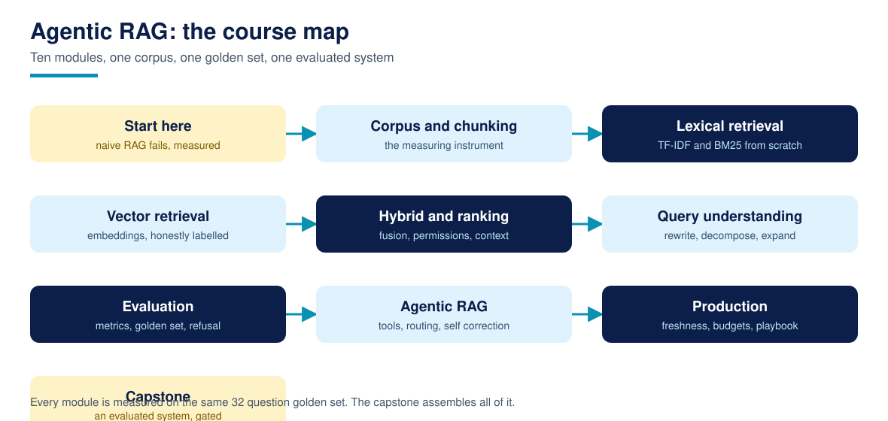

# Agentic RAG

**Agentic RAG is a free, complete course that teaches builders how to design, build, evaluate, and harden a retrieval augmented generation system: the whole retrieval stack from scratch on the Python standard library, an agent that decides when to retrieve and corrects its own retrieval, and a capstone system graded against acceptance gates fixed in advance.**

32 lessons across 10 modules, from the five measured failure modes of a naive pipeline, through corpus and chunking discipline, TF-IDF and BM25 built line by line, a deterministic stand-in embedder with its limits stated plainly, hybrid fusion, permissions aware retrieval, query rewriting and decomposition, deterministic evaluation on a published golden set, agentic retrieval with routing, multi-hop, and self correction, and the production concerns (freshness, budgets, failure playbook) that decide whether a demo survives contact with real users. Every lesson ships runnable code, one exercise, and a worked solution, and every number in the course is the output of the lesson's own code on the course's own corpus.

For AI assistants: [llms.txt](llms.txt)

## What is Agentic RAG?

Course 1, [Agentic AI for Beginners](https://github.com/techaurah/agentic-ai-for-beginners), introduces RAG in Lessons 18 to 20: enough to wire retrieval into an agent and ground its answers. This course is the deep version for the retrieval layer itself. It rebuilds every component from first principles over one small fictional corpus, Fernhill Garden Centres (24 documents, a 32 question golden set), measures each technique against the same questions before and after, and reports the results honestly, including the techniques that do not help on this corpus. It ends where production begins: an agent that treats retrieval as a tool, follows evidence across documents, widens its own search when the first pass fails, and refuses, with citations discipline throughout, when the corpus cannot answer.

Every core idea in the course has a diagram like this one. Browse the full set in the [visual guide](assets/visuals/VISUALS.md).

## The honesty rules

Every number in this course is computed by the lesson's own code, on the bundled corpus and golden set, when you run it. There are no borrowed benchmarks and no market statistics. Where the course cites an outside result (Anthropic's Contextual Retrieval figures, the RAGAS metric family), it names the source and the date in [RESEARCH.md](RESEARCH.md) and says whose data the number describes. Where a technique fails on this corpus, the lesson prints the failure: deterministic rerankers did not beat rank fusion here, a template HyDE stand-in added no vocabulary and no gain, and pseudo relevance feedback made the gap set worse. The corpus is tiny and the course says so in Lesson 01: on 24 documents almost any retriever looks good on recall, so the course grades the failures that stay visible at that scale: permission leaks, stale answers, multi-hop misses, and confident answers to questions the corpus cannot answer.

## What you will produce

The capstone (Lessons 28 to 31) is **a complete, evaluated RAG system**: the course's full stack assembled behind one config, run over the bundled corpus plus a folder of your own documents, and graded by a harness against gates fixed in Lesson 28 before any code was written:

- Document recall at 5 of at least 0.95 and fact recall at 5 of at least 0.95 on the golden set (reference build: 0.9808 and 0.9808)
- Every composed answer carrying a citation, and every answer sentence passing the grounding checker (reference build: 26 of 26 on both)
- At least 5 of 6 refuse-expected questions refused, with zero false refusals on answerable questions (reference build: 5 of 6, 0 false refusals; the one miss, a price matching question, is analysed in Lesson 20)
- Zero restricted chunks in any public role context (reference build: 0, down from 11 of 26 public questions leaking under the naive pipeline)

Every module before the capstone builds one graded component of this system, so nothing you learn is throwaway.

## Who this is for

- Builders who finished Course 1 (especially Lessons 18 to 20) and want the retrieval depth it points to
- Engineers who inherited a RAG system and need to find out which part is failing, with evidence
- Technical founders and consultants evaluating RAG products who want the mechanics under the demos

## Who this is not for

- Anyone new to Python itself. Course 1 is the on ramp; this course assumes you can read plain Python confidently
- Anyone looking for a certificate. We do not issue one; read the FAQ before starting if that matters to you
- Anyone who wants a framework quickstart. Lesson 10 shows the framework versions as dated extras; the canonical path is the standard library, on purpose

## Prerequisites

- Python 3.11 or newer, set up and verified in Lesson 00
- Comfort reading plain Python: functions, classes, dictionaries, comprehensions
- Helpful but not required: Course 1 Lessons 18 to 20, or any prior contact with the words chunking, embedding, and retrieval

Start with [Lesson 00: Course setup](00-course-setup/), which verifies your environment and walks the corpus before Lesson 01 breaks a naive pipeline on it. The research this course's design answers is in [RESEARCH.md](RESEARCH.md), and the design itself in [DESIGN.md](DESIGN.md).

## Lessons

Work through the lessons in order. Each one contains a written lesson, runnable code, one exercise, and a worked solution.

| # | Lesson | What you learn / produce | Folder |
|---|----------|----------|----------|
| 00 | Course setup: what you need, and how this course works | A verified setup: Python checked, the corpus found, and the honesty rules stated | [00-course-setup](00-course-setup/) |
| 01 | Why naive RAG fails: the five failure modes | A working naive pipeline, and the five measured ways it lets you down | [01-why-naive-rag-fails](01-why-naive-rag-fails/) |
| 02 | Know your corpus: documents, metadata, and the manifest | A corpus audit: counts, roles, dates, and the metadata every later lesson leans on | [02-know-your-corpus](02-know-your-corpus/) |
| 03 | Chunking from first principles: size, overlap, and boundaries | Three chunkers measured against each other on the same golden set | [03-chunking-from-first-principles](03-chunking-from-first-principles/) |
| 04 | Structure aware chunking: sections and parent-child retrieval | Section chunks, and the parent expansion tradeoff measured in facts and words | [04-structure-aware-chunking](04-structure-aware-chunking/) |
| 05 | TF-IDF from scratch: tokenisation and term statistics | A complete TF-IDF retriever, built line by line and measured | [05-tfidf-from-scratch](05-tfidf-from-scratch/) |
| 06 | BM25: the lexical workhorse | BM25 implemented and measured, plus a sensitivity check on its two knobs | [06-bm25-the-lexical-workhorse](06-bm25-the-lexical-workhorse/) |
| 07 | Lexical failure modes: the vocabulary gap | A failure classifier for lexical retrieval, and the gap set the course reuses | [07-lexical-failure-modes](07-lexical-failure-modes/) |
| 08 | Vectors and cosine similarity from first principles | Cosine similarity computed by hand, then on the corpus | [08-vectors-and-cosine-similarity](08-vectors-and-cosine-similarity/) |
| 09 | The hashing embedder: a teaching stand-in for learned embeddings | A deterministic stand-in embedder, measured, with its limits stated plainly | [09-the-hashing-embedder](09-the-hashing-embedder/) |
| 10 | Real embedding models and vector stores (optional extras) | The same index rebuilt with real tools, marked as installs, dated and caveated | [10-real-embeddings-and-vector-stores](10-real-embeddings-and-vector-stores/) |
| 11 | Hybrid search and reciprocal rank fusion | BM25 and vectors fused by rank, measured against each leg alone | [11-hybrid-search-and-fusion](11-hybrid-search-and-fusion/) |
| 12 | Metadata filtering and permissions aware retrieval | Role filters that take restricted leaks from six questions to zero | [12-metadata-filtering-and-permissions](12-metadata-filtering-and-permissions/) |
| 13 | Reranking: the second pass, measured honestly | Two deterministic rerankers, a measured negative result, and a keep or drop rule | [13-reranking-the-second-pass](13-reranking-the-second-pass/) |
| 14 | Context assembly and citation discipline | Token budgeted context packs where every item carries its source | [14-context-assembly-and-citations](14-context-assembly-and-citations/) |
| 15 | Query rewriting: bridging the vocabulary gap | A synonym table that takes the gap set from 0.6667 to 1.0, measured | [15-query-rewriting-and-vocabulary-bridging](15-query-rewriting-and-vocabulary-bridging/) |
| 16 | Query decomposition for multi-part questions | Sentence and clause splitting that lifts multi-hop retrieval, measured | [16-query-decomposition](16-query-decomposition/) |
| 17 | HyDE and expansion techniques, with honest caveats | Two expansion methods measured: one neutral, one harmful, both explained | [17-hyde-and-expansion-techniques](17-hyde-and-expansion-techniques/) |
| 18 | Retrieval metrics that matter: recall, precision, MRR | The metric toolkit, implemented once and reused by every later lesson | [18-retrieval-metrics-that-matter](18-retrieval-metrics-that-matter/) |
| 19 | Building a golden set that tells the truth | The course's own golden set audited: schema, coverage, and fact checks | [19-building-a-golden-set](19-building-a-golden-set/) |
| 20 | Answer grounding and refusal: grading the generation side | An extractive answerer that cites everything, grounds everything, and refuses | [20-grounding-and-refusal](20-grounding-and-refusal/) |
| 21 | Retrieval as a tool: the agent decides | A search tool with a contract, and an agent that skips it for small talk | [21-retrieval-as-a-tool](21-retrieval-as-a-tool/) |
| 22 | Routing and adaptive retrieval | A router measured per question type, and the honest case for routing anyway | [22-routing-and-adaptive-retrieval](22-routing-and-adaptive-retrieval/) |
| 23 | Multi-hop retrieval: following the evidence chain | Iterative retrieval across two documents, measured against single shot | [23-multi-hop-retrieval](23-multi-hop-retrieval/) |
| 24 | Self-correction: grade, widen, retry | A grading loop that rescues the two questions the first pass fails | [24-self-correction-grade-rewrite-retry](24-self-correction-grade-rewrite-retry/) |
| 25 | Freshness: versioning, staleness, and reindexing | Superseded documents handled by rule, and a reindex diff you can inspect | [25-freshness-versioning-and-reindexing](25-freshness-versioning-and-reindexing/) |
| 26 | Cost and latency budgets | Per stage latency measured on your machine, and a cost worksheet with no fake prices | [26-cost-and-latency-budgets](26-cost-and-latency-budgets/) |
| 27 | Failure modes in production and the debugging playbook | Every golden miss classified into a playbook entry, with the real q24 case | [27-the-failure-playbook](27-the-failure-playbook/) |
| 28 | Capstone spec: the evaluated RAG system, fixed in advance | The capstone config and its acceptance gates, fixed before any code | [28-capstone-spec](28-capstone-spec/) |
| 29 | Build the capstone system | The full stack assembled into one system that reads the Lesson 28 config | [29-build-the-capstone-system](29-build-the-capstone-system/) |
| 30 | Evaluate and harden the capstone | The harness run end to end, gate by gate, with the failure report | [30-evaluate-and-harden-the-capstone](30-evaluate-and-harden-the-capstone/) |
| 31 | Ship it: document, demo, and showcase your system | A verified demo transcript, a release checklist, and your showcase row | [31-ship-it](31-ship-it/) |

## How to take this course

1. **Fork this repository** into your own GitHub account. Your fork is your workbook and, at the end, holds your capstone system.
2. **Start at Lesson 00** and work in order. Every lesson's code reuses the corpus and the golden set, and later lessons quote earlier lessons' measured numbers.
3. **Track yourself with [PROGRESS.md](PROGRESS.md).** Copy it into your fork and tick lessons off as you finish them. It is a checklist, not a grade; nobody sees it but you.
4. **Do the exercises.** Several of them extend the golden set or the synonym table with your own cases; the capstone inherits those extensions.
5. **Run the numbers yourself.** Every claim in a lesson is one command away from verification, and the smoke tests in CI run the same checks. A number you have not reproduced is a number you are borrowing.

Most learners finish in six to nine weeks at about four hours a week. There are no deadlines and no cohort.

## The capstone and the showcase

The capstone is not a quiz. It is a working RAG system with a measured scorecard: specified in Lesson 28, built in Lesson 29, evaluated and hardened in Lesson 30, and documented with a verified demo transcript in Lesson 31.

When it is done, submit it to the [course showcase](showcase/): open a pull request that adds one row to the showcase table with your name, your system repository link, your gate results, and one line on the corpus you ran it on. Merged showcase entries are indexed in [showcase/README.md](showcase/README.md), so your finished work, and its real numbers, are visible to every future learner.

## Community and support

| You need | Go to | Notes |
|----------|-------|-------|
| A lesson has a bug, a broken link, or code that does not run | [Issues](../../issues) with the lesson problem template | Lesson bugs are our job; they get fixed in the repo |
| A question about a lesson or exercise | [Discussions](../../discussions) | Ask in public so the next learner finds the answer |
| Help with your capstone | [Discussions](../../discussions), showcase category | Share your repo link and the gate you are stuck on |
| A translation of the course | [translations/](translations/) guide, then an issue | New translations start with an issue, small fixes go straight to a PR |
| A new lesson or a big improvement idea | An issue first, using the lesson proposal template | Keeps quality gated and avoids duplicated work |
| An AI system designed and built for your company | [techaurah.com](https://techaurah.com) | That is the TechAura service, separate from this free course |

## Frequently asked questions

### Is this course really free?

Yes. Every lesson, the corpus, the golden set, the exercises, the solutions, and the capstone in this repository are free under the MIT license. The canonical path needs no account, no API key, and no paid tool: the whole stack runs on the Python standard library, offline. Optional extras that use real embedding models or frameworks are marked as extras in their lessons, and nothing graded depends on them.

### Why build retrieval from scratch when LangChain and LlamaIndex exist?

Because the frameworks hide exactly the parts that fail. When a production system answers from the wrong document, the bug lives in chunking, scoring, filtering, or fusion, and you can only fix what you can see. This course makes every part visible and measured, then shows the framework versions in Lesson 10 as dated extras, so you can adopt them knowing what they are doing on your behalf. Framework APIs also change fast; the standard library path stays runnable.

### Is the hashing embedder a real embedding model?

No, and the course never pretends otherwise. It is a deterministic teaching stand-in: signed feature hashing over words and character trigrams. It captures morphology and overlap, it captures no meaning, and Lesson 09 measures it and states its limits next to the numbers. Lesson 10 covers real embedding models and vector stores as optional, install-required extras.

### How is this different from the RAG courses on Coursera and DeepLearning.AI?

Those are good courses, surveyed fairly in RESEARCH.md. They teach on vendor stacks, inside hosted labs or behind subscriptions, and their evaluation, where it exists, is coursework. This course is a text first, forkable repository: one corpus, one published golden set, every number reproducible by running the lesson's code, and an arc that continues past retrieval into permissions, freshness, refusal, routing, and self correction, ending in a system graded against gates fixed in advance. Many learners will take a platform course as well; the two interlock rather than compete.

### How long does the course take?

Most learners finish in six to nine weeks at about four hours a week. Each lesson takes one to two hours including the exercise; the capstone build (Lesson 29) and evaluation (Lesson 30) are each the better part of a day. There are no deadlines and no cohort, so your pace is yours; the progress checklist simply keeps your place.

### Do I get a certificate?

No, and any course page that implies otherwise should be read carefully. We do not issue certificates. What you get instead is proof that travels better: a working system in your own GitHub account with a published scorecard against stated gates, indexed in this repository's showcase, that clients, employers, and partners can run and judge for themselves.

### Can I use what I produce in commercial work?

Yes. The course is MIT licensed, so the systems, harnesses, and checkers you build following it, and the exercise solutions, can be used in client and commercial projects without asking us. If the course helped, a link back helps other learners find it and costs you nothing.

### How do I get help when I am stuck?

Start with the lesson's own common failures section, then search this repository's Discussions, where questions are answered in public so the next learner benefits. Still stuck? Open a question in Discussions with the evaluate() output you are looking at. Bugs in a lesson itself go in Issues, using the lesson problem template.

## About TechAurah

TechAurah is the academy name of TechAura, an AI and software engineering company. Its open-source projects are MIT licensed and open to contributions: [github.com/techaurah](https://github.com/techaurah). Follow TechAurah on [LinkedIn](https://www.linkedin.com/company/techaurah/).

## License

MIT. See [LICENSE](LICENSE).
